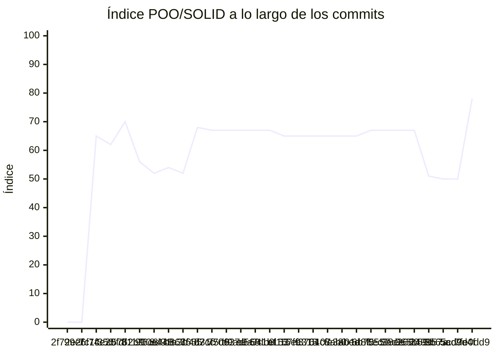

<!-- evaluacion:inicio -->
# Evaluación — Juli-team/Simulador-caida-libre

> Documento **generado automáticamente** por la cátedra de Programación II (RepoSense + análisis de calidad POO/SOLID). **No editar a mano**: se regenera en cada evaluación.
> Rama evaluada: `main`. Análisis **heurístico** (regex + métricas): es una criba para orientar la revisión, **no una nota**.
> Generado: 2026-11-27.

## 1. Veredicto

| Aspecto | Resultado |
|---|---|
| Índice de calidad POO/SOLID | **78/100** |
| Commit evaluado | `7fe0dd99a1e3` (2026-11-27) |
| Código (LOC) | 2,581 |
| Archivos de código | 24 |
| Clases (bien usadas) | 47 (12 OK) |
| Código dentro de clases (%POO) | 97% |
| Funciones fuera de clases | 0 |
| Duplicación lógica | 0.0% |
| Señales S/O/L/I/D | 2/1/0/0/3 |

> Este informe **describe** lo que el análisis midió con los criterios ya establecidos de la materia. No es una nota.

### Semáforo de aprobación

Criterios de `CRITERIOS-CALIDAD.md`. **Aprobar** se juega con el perfil `estandar`; **destacar**, con el `exigente` (meta de excelencia).

| Semáforo | Resultado |
|---|---|
| Aprobar (`estandar`) | **no cumple** — 3/4 |
| Destacar (`exigente`) | **no cumple** — 4/5 |

**Criterios para aprobar**

| Criterio | Requisito | Tu resultado | Cumple |
|---|---|---|---|
| Código dentro de clases (%POO) | ≥ 85% | 97% | sí |
| Duplicación lógica | ≤ 10% | 0.0% | sí |
| Funciones fuera de clases | ≤ 1 | 0 | sí |
| Señales POO/SOLID críticas | ninguna | Baja cohesión (LCOM), Acoplamiento alto (CBO) | no |

**Criterios para destacar**

| Criterio | Requisito | Tu resultado | Cumple |
|---|---|---|---|
| Código dentro de clases (%POO) | ≥ 95% | 97% | sí |
| Duplicación lógica | ≤ 5% | 0.0% | sí |
| Funciones fuera de clases | ≤ 1 | 0 | sí |
| Señales POO/SOLID críticas | ninguna | Baja cohesión (LCOM), Acoplamiento alto (CBO), Switch sobre tipos (OCP) | no |
| Índice de calidad POO/SOLID | ≥ 60 | 78/100 | sí |

### Última actividad en cualquier rama

> Datos al cierre de la evaluación, antes de publicar este informe. Se revisan todas las ramas (`refs/heads/*`) y los heads de PR (`refs/pull/*/head`); **último commit de alumno** excluye la cuenta docente y los bots.

| | Fecha (UTC-3) | Usuario | Rama | Commit | Mensaje |
|---|---|---|---|---|---|
| Último commit | 2026-11-27 03:06 | @dqmdz-etec | `main` | `7fe0dd99` | Merge pull request #32 from Juli-team/31-corregir-señales-poosolid |
| Último commit de alumno | 2026-11-26 22:00 | @julianosm1123 | `31-corregir-señales-poosolid` | `afc8d00e` | correccion de señales poo/solid |

### Cómo se calcula el %POO (y por qué no sube solo)

`%POO = líneas de lógica dentro de clases ÷ líneas de lógica totales`.

Se cuentan las líneas de **lógica y campos**; no cuentan `package`/`import`/`using`/anotaciones ni comentarios, Javadoc o docstrings. Es una **proporción**: si agregás código nuevo dentro de una clase, el numerador y el denominador crecen juntos y el porcentaje casi no cambia.

Sube cuando el código que hoy está **fuera** de clases pasa a ser método de una clase (o desaparece): funciones sueltas, `main`, constantes de módulo, scripts y lógica de archivos sueltos. También importa que ese trabajo esté **integrado en `main`**: la evaluación siempre mide `main`, así que lo que sigue en otra rama no se refleja todavía.

## 2. Autoría (RepoSense)

| Autor | Commits | Código (LOC) | Tests (LOC) | Docs (LOC) | Días activos | % del código |
|---|---:|---:|---:|---:|---:|---:|
| Julián San Martín | 16 | 34 | 0 | 443 | 17 | 100% |

> _El LOC de autoría lo calcula RepoSense sobre el historial y puede diferir del LOC de código del análisis de calidad (que mira solo el estado de `main`)._

## 3. Fallas detectadas

Reúne lo que el análisis marcó y lo que todavía falta para cada semáforo. Cuando la señal se puede asociar a archivos, se indican para orientar la revisión. No es una nota.

| Falla | Tu resultado | Requisito | Archivos |
|---|---|---|---|
| Señales POO/SOLID críticas | Baja cohesión (LCOM), Acoplamiento alto (CBO) | Aprobar: ninguna Destacar: ninguna | `código/física/poc.ts`, `código/simulación/bucle.ts`, `código/simulación/controlesNavegacion.ts`, `código/simulación/dibujarMenu.ts`, `código/simulación/dibujarPOC.ts`, `código/simulación/estadoBola.ts` |
| Métodos/funciones largos o con muchos parámetros | **7** método(s)/función(es) largos o con muchos parámetros | Sin señales | `código/física/calculos.ts`, `código/simulación/dibujarMapa.ts`, `código/simulación/hud.ts`, `código/simulación/impacto.ts`, `código/simulación/mano.ts` |
| Clase solo con métodos estáticos (utilitaria) | **1** clase(s) solo con métodos estáticos | Sin señales | `código/física/constantes.ts` |

## 4. Aspectos evaluados

Cada aspecto indica **qué mide**, **por qué importa** y **tu resultado**. Cuando el análisis reportó una señal, se agregan preguntas para **investigar la causa** (no hay recetas: entender el porqué es parte de la evaluación).

### 1. Índice de calidad POO/SOLID (indice)

- **Qué mide:** Un resumen numérico (0-100) que combina la riqueza de clases bien usadas con la penalización por señales POO/SOLID y duplicación, y luego aplica topes duros.
- **Por qué importa:** Ordena y prioriza la revisión: un índice bajo indica varias señales que conviene mirar juntas.
- **Tu resultado:** índice **78/100**

### 2. Duplicación lógica (DRY) (duplicacion) — sin señales

- **Qué mide:** Porcentaje de bloques de LÓGICA repetidos. Quedan fuera imports/includes, anotaciones, declaraciones de campos y comentarios/Javadoc/docstrings: esos bloques son boilerplate, no lógica.
- **Por qué importa:** Cada copia de lógica se mantiene por separado: un arreglo hay que repetirlo y los defectos se multiplican.
- **Tu resultado:** **0.0%** de duplicación lógica

### 3. Adopción de POO (% de código en clases) (poo) — sin señales

- **Qué mide:** Proporción de las **líneas de lógica** que viven dentro de una clase. Quedan fuera `package`/`import`/`using`/anotaciones y comentarios/Javadoc/docstrings: no son código que pueda estar dentro de una clase y, si contaran, el porcentaje quedaría topado por el boilerplate de cada archivo.
- **Por qué importa:** El diseño orientado a objetos es el eje de la materia: el comportamiento debería vivir como método de una clase.
- **Tu resultado:** **97.3%** del código dentro de clases
- **Cómo leerlo:** Es una **proporción**, no un acumulado: agregar código dentro de una clase no la sube por sí solo (numerador y denominador crecen juntos). Sube cuando el código que está **fuera** de clases (funciones sueltas, `main`, constantes de módulo, scripts) pasa a ser método de una clase o deja de existir. La medición se hace sobre `main`: el trabajo que todavía vive en otra rama no se refleja hasta que se integra.

### 4. Funciones fuera de clases (sueltas) — sin señales

- **Qué mide:** Funciones de nivel de módulo que no pertenecen a ninguna clase (en esta materia el comportamiento debe ser método de una clase).
- **Por qué importa:** Son la forma más directa de código procedural en un proyecto que debería ser orientado a objetos.
- **Tu resultado:** **0** función(es) fuera de clases

### 5. Clase demasiado grande (SRP) (god) — sin señales

- **Qué mide:** Clases con demasiadas líneas o métodos de LÓGICA. No cuentan los getters/setters triviales ni la cantidad de campos por sí sola.
- **Por qué importa:** Una clase que hace de todo cambia por muchos motivos y cuesta entenderla y probarla.
- **Tu resultado:** **0** clase(s) demasiado grande(s)

### 6. Baja cohesión (LCOM) (cohesion) — con señales

- **Qué mide:** Métodos y campos de una clase que casi no se relacionan entre sí.
- **Por qué importa:** Una unidad que cambia por motivos distintos y comparte poca información suele esconder más de una responsabilidad.
- **Tu resultado:** **2** clase(s) con baja cohesión
- **Para investigar la causa:**
    - ¿Qué métodos de la clase no comparten estado con el resto?
    - ¿Cambian por motivos distintos según la tarea?
    - ¿Se pensó su responsabilidad antes de escribirla, o se fue agregando?

### 7. Complejidad alta (complejidad) — sin señales

- **Qué mide:** Complejidad ciclomática: cantidad de caminos posibles dentro de un método o función (condicionales, bucles, casos).
- **Por qué importa:** Muchos caminos = difícil de seguir y de probar; suelen esconderse casos sin cubrir.
- **Tu resultado:** **0** método(s)/función(es) con complejidad alta

### 8. Métodos/funciones largos o con muchos parámetros (tamano) — con señales

- **Qué mide:** Tamaño de los métodos/funciones y cantidad de parámetros.
- **Por qué importa:** Una función que hace varias cosas cuesta leerla, nombrarla y reutilizarla.
- **Tu resultado:** **7** método(s)/función(es) largos o con muchos parámetros
- **Para investigar la causa:**
    - ¿La función creció por acumulación de pasos?
    - ¿Agrupa operaciones que podrían describirse por separado?
    - ¿Los parámetros representan una misma idea (un objeto) o cosas sueltas?

### 9. Acoplamiento alto (CBO) (acoplamiento) — con señales

- **Qué mide:** Cuánto depende una clase de otros tipos del proyecto. No cuentan los tipos de la plataforma (biblioteca estándar, DOM, motor Godot) ni los métodos/propiedades propias.
- **Por qué importa:** Piezas muy enlazadas hacen que un cambio se propague y que sea difícil reemplazar partes.
- **Tu resultado:** **3** clase(s) muy acoplada(s)
- **Para investigar la causa:**
    - ¿La clase conoce detalles internos de muchas otras?
    - ¿Se puede cambiar una parte sin tocar las demás?
    - ¿Los colaboradores llegan como parámetros o se crean por dentro?

### 10. Herencia profunda (DIT) (herencia) — sin señales

- **Qué mide:** Profundidad de la cadena de herencia de una clase.
- **Por qué importa:** Jerarquías muy profundas vuelven difícil saber de dónde viene cada comportamiento.
- **Tu resultado:** **0** clase(s) con herencia profunda

### 11. Switch sobre tipos (OCP) (ocp) — con señales

- **Qué mide:** Cadenas de dispatch por tipo (`else if ... is` / `else if ... instanceof`, `switch` sobre tipo o `typeof`). Un `is Tipo variable` aislado (pattern matching / cast seguro) NO cuenta como switch.
- **Por qué importa:** Cada tipo nuevo obliga a tocar varios lugares, en vez de extender con una implementación nueva.
- **Tu resultado:** **1** clase(s) con switch sobre tipos
- **Para investigar la causa:**
    - ¿Qué operación se resuelve preguntando el tipo?
    - ¿Qué se toca cada vez que aparece un tipo o caso nuevo?
    - ¿El comportamiento podría vivir en la propia jerarquía de tipos?

### 12. Interfaz con demasiados métodos (ISP) (isp) — sin señales

- **Qué mide:** Interfaces o clases abstractas con muchos métodos declarados.
- **Por qué importa:** Obliga a implementar operaciones que no se usan y acopla a los clientes a métodos que no necesitan.
- **Tu resultado:** **0** interfaz(es) con demasiados métodos

### 13. Override vacío o 'no implementado' (LSP) (lsp) — sin señales

- **Qué mide:** Métodos sobrescritos que quedan vacíos o lanzan 'no implementado'.
- **Por qué importa:** Suele indicar que la jerarquía no representa bien el problema y rompe la sustitución entre clases.
- **Tu resultado:** **0** override(s) vacío(s) o 'no implementado'

### 14. Clase sin métodos (solo datos) (data) — sin señales

- **Qué mide:** Clases que solo acumulan campos y no tienen comportamiento.
- **Por qué importa:** Separar datos de comportamiento reparte por el proyecto la lógica que debería estar cerca de esos datos.
- **Tu resultado:** **0** clase(s) sin métodos (solo datos)

### 15. Campos mutables públicos (encapsulación) (encapsulacion) — sin señales

- **Qué mide:** Clases que exponen estado **modificable** desde afuera. No cuentan constantes (`static final`, `const`), campos `final`/`readonly`, propiedades `val` de Kotlin ni propiedades con `private set`.
- **Por qué importa:** Expone el estado interno y hace que cualquier cambio dependa de quién lo modifica desde afuera.
- **Tu resultado:** **0** clase(s) con campos mutables públicos

### 16. Clase solo con métodos estáticos (utilitaria) (static) — con señales

- **Qué mide:** Clases donde todos los métodos son estáticos.
- **Por qué importa:** Es comportamiento procedural disfrazado de clase: no se instancia ni participa del modelo de objetos.
- **Tu resultado:** **1** clase(s) solo con métodos estáticos
- **Para investigar la causa:**
    - ¿Por qué no hace falta una instancia en esa clase?
    - ¿Los métodos operan sobre estado que podría vivir en un objeto?
    - ¿Se usó clase solo para agrupar funciones sueltas?

### Resumen de señales por tipo

| Señal | Cantidad | Principio | Archivos |
|---|---:|---|---:|
| método largo | 7 | S | 5 |
| acoplamiento alto | 3 | D | 3 |
| baja cohesión | 2 | S | 2 |
| clase estática | 1 | OOP | 1 |
| switch de tipos | 1 | O | 1 |

### Resumen por archivo

> Archivos ordenados por cantidad de señales. Se excluyen **0** señal(es) de nivel repositorio sin archivo propio.

| Archivo | Señales | Aspectos | Líneas |
|---|---:|---|---|
| `código/simulación/dibujarMapa.ts` | 2 | tamaño | 45, 111 |
| `código/simulación/hud.ts` | 2 | tamaño | 27, 66 |
| `código/física/calculos.ts` | 1 | tamaño | 93 |
| `código/física/constantes.ts` | 1 | estático | 35 |
| `código/física/poc.ts` | 1 | cohesión | 23 |
| `código/simulación/bucle.ts` | 1 | acoplamiento | 15 |
| `código/simulación/controlesNavegacion.ts` | 1 | cohesión | 11 |
| `código/simulación/dibujarMenu.ts` | 1 | acoplamiento | 8 |
| `código/simulación/dibujarPOC.ts` | 1 | OCP | 17 |
| `código/simulación/estadoBola.ts` | 1 | acoplamiento | 20 |
| `código/simulación/impacto.ts` | 1 | tamaño | 65 |
| `código/simulación/mano.ts` | 1 | tamaño | 96 |

### Archivos donde se originan las señales

> Se listan **14** hallazgo(s) localizados en **12** archivo(s). La columna `Línea` es la línea del archivo donde el análisis detectó la señal; `—` indica una señal de nivel repositorio (sin archivo propio).

| Aspecto | Archivo | Línea | Hallazgo |
|---|---|---:|---|
| Baja cohesión (LCOM) | `código/física/poc.ts` | 23 | clase 'POC' con baja cohesión (13%) |
| Baja cohesión (LCOM) | `código/simulación/controlesNavegacion.ts` | 11 | clase 'ControlesNavegacion' con baja cohesión (49%) |
| Métodos/funciones largos o con muchos parámetros | `código/física/calculos.ts` | 93 | método 'Calculos.actualizar' de 47 líneas |
| Métodos/funciones largos o con muchos parámetros | `código/simulación/dibujarMapa.ts` | 45 | método 'DibujarMapa.cargarImagen' de 32 líneas |
| Métodos/funciones largos o con muchos parámetros | `código/simulación/dibujarMapa.ts` | 111 | método 'DibujarMapa.dibujar' de 54 líneas |
| Métodos/funciones largos o con muchos parámetros | `código/simulación/hud.ts` | 27 | método 'HUD.actualizar' de 34 líneas |
| Métodos/funciones largos o con muchos parámetros | `código/simulación/hud.ts` | 66 | método 'HUD.dibujar' de 55 líneas |
| Métodos/funciones largos o con muchos parámetros | `código/simulación/impacto.ts` | 65 | método 'Impacto.dibujar' de 61 líneas |
| Métodos/funciones largos o con muchos parámetros | `código/simulación/mano.ts` | 96 | método 'Mano.dibujar' de 48 líneas |
| Acoplamiento alto (CBO) | `código/simulación/bucle.ts` | 15 | clase 'Bucle' muy acoplada (CBO=15) |
| Acoplamiento alto (CBO) | `código/simulación/dibujarMenu.ts` | 8 | clase 'DibujarMenu' muy acoplada (CBO=8) |
| Acoplamiento alto (CBO) | `código/simulación/estadoBola.ts` | 20 | clase 'EstadoBola' muy acoplada (CBO=8) |
| Switch sobre tipos (OCP) | `código/simulación/dibujarPOC.ts` | 17 | clase 'DibujarPOC' con 1 cadenas de type-check |
| Clase solo con métodos estáticos (utilitaria) | `código/física/constantes.ts` | 35 | clase 'Constantes' solo con métodos estáticos (¿utilitaria?) |

### Clases señaladas — métricas

> Solo clases con al menos una señal. `LOC lóg.` y `Mét. lóg.` descuentan getters/setters; `LCOM` es la cantidad de pares de métodos sin campos en común.

| Clase | Archivo | Línea | LOC lóg. | Mét. lóg. | Campos | CBO | LCOM | Cohesión | WMC | RFC | Señales |
|---|---|---:|---:|---:|---:|---:|---:|---:|---:|---:|---|
| `DibujarMapa` | `código/simulación/dibujarMapa.ts` | 25 | 131 | 6 | 3 | 1 | 0 | 100% | 22 | 40 | método largo×2 |
| `HUD` | `código/simulación/hud.ts` | 10 | 89 | 2 | 5 | 2 | 0 | 100% | 8 | 16 | método largo×2 |
| `DibujarMenu` | `código/simulación/dibujarMenu.ts` | 8 | 180 | 14 | 6 | 8 | 12 | 82% | 52 | 68 | acoplamiento alto×1 |
| `Bucle` | `código/simulación/bucle.ts` | 15 | 114 | 12 | 16 | 15 | 25 | 55% | 29 | 66 | acoplamiento alto×1 |
| `Impacto` | `código/simulación/impacto.ts` | 3 | 90 | 5 | 5 | 2 | 0 | 100% | 9 | 36 | método largo×1 |
| `ControlesNavegacion` | `código/simulación/controlesNavegacion.ts` | 11 | 71 | 11 | 9 | 6 | 23 | 49% | 35 | 39 | baja cohesión×1 |
| `Calculos` | `código/física/calculos.ts` | 12 | 61 | 4 | 5 | 5 | 2 | 67% | 6 | 38 | método largo×1 |
| `EstadoBola` | `código/simulación/estadoBola.ts` | 20 | 57 | 15 | 6 | 8 | 0 | 100% | 21 | 48 | acoplamiento alto×1 |
| `Mano` | `código/simulación/mano.ts` | 15 | 48 | 1 | 13 | 3 | 0 | 100% | 6 | 13 | método largo×1 |
| `DibujarPOC` | `código/simulación/dibujarPOC.ts` | 17 | 36 | 2 | 3 | 2 | 0 | 100% | 5 | 22 | switch de tipos×1 |
| `POC` | `código/física/poc.ts` | 23 | 23 | 6 | 10 | 2 | 13 | 13% | 6 | 29 | baja cohesión×1 |
| `Constantes` | `código/física/constantes.ts` | 35 | 13 | 2 | 0 | 1 | 0 | 100% | 2 | 6 | clase estática×1 |

### Métodos y funciones señalados

> Filas ordenadas por complejidad, tamaño y parámetros. Una misma fila puede acumular más de una señal.

| Archivo | Línea | Método / función | LOC | Parámetros | Complejidad | Señales |
|---|---:|---|---:|---:|---:|---|
| `código/simulación/impacto.ts` | 65 | `Impacto.dibujar` | 61 | — | — | método largo |
| `código/simulación/hud.ts` | 66 | `HUD.dibujar` | 55 | — | — | método largo |
| `código/simulación/dibujarMapa.ts` | 111 | `DibujarMapa.dibujar` | 54 | — | — | método largo |
| `código/simulación/mano.ts` | 96 | `Mano.dibujar` | 48 | — | — | método largo |
| `código/física/calculos.ts` | 93 | `Calculos.actualizar` | 47 | — | — | método largo |
| `código/simulación/hud.ts` | 27 | `HUD.actualizar` | 34 | — | — | método largo |
| `código/simulación/dibujarMapa.ts` | 45 | `DibujarMapa.cargarImagen` | 32 | — | — | método largo |

### Umbrales aplicados (perfil exigente)

| Señal | Regla |
|---|---|
| Clase grande (SRP) | ≥ 200 LOC lógico, o ≥ 15 métodos con lógica y ≥ 100 LOC lógico; no cuentan getters/setters. |
| Baja cohesión (LCOM) | < 50 % de pares de métodos comparten algún campo, con ≥ 4 métodos con lógica y ≥ 3 campos. |
| Complejidad alta | algún método con complejidad ciclomática ≥ 10. |
| Método largo | ≥ 30 líneas. |
| Muchos parámetros | > 4 parámetros (5 o más). |
| Acoplamiento alto (CBO) | CBO ≥ 8. |
| Herencia profunda | DIT ≥ 3. |
| Type-check / switch de tipos | ≥ 1 cadena de type-check. |
| Interfaz demasiado grande (ISP) | > 6 métodos (7 o más). |
| Override vacío (LSP) | método vacío o marcado como 'no implementado'. |
| Clase solo de datos | 0 métodos y ≥ 3 campos. |
| Campos mutables públicos | ≥ 4 campos mutables públicos y ≥ 4 campos. |
| Clase estática | ≥ 2 métodos y todos estáticos. |
| Duplicación lógica | ventana de 8 líneas; solo lógica; se informa desde 1 %. |

### Desglose de la columna S (SRP)

> La columna **S** no es un puntaje: cuenta **señales** de SRP. Aquí suma **2** entrada(s) sobre **2** clase(s) distinta(s).

| Señal | Entradas | Regla (perfil exigente) |
|---|---:|---|
| Cohesión baja | 2 | < 50 % de los pares de métodos comparten algún campo (con ≥ 4 métodos con lógica y ≥ 3 campos). |

**Clases con baja cohesión (2)**

- `POC`: cohesión baja (13% de pares comparten campos)
- `ControlesNavegacion`: cohesión baja (49% de pares comparten campos)

> Los **7** hallazgo(s) de métodos largos o con muchos parámetros se listan en «Métodos/funciones largos o con muchos parámetros» y **no suman** a la columna S.

> El análisis no excluye tests: una clase de test que supere los umbrales también suma.

## 5. Evolución por commit

Métricas calculadas sobre el estado de `main` en **cada commit** (29 commits con trabajo), del primero al último. La calidad usa el perfil `exigente`; el aporte de código lo mide RepoSense. El índice puede **bajar** al crecer el proyecto: se acumulan señales.

| # | Fecha | Commit | Autor | LOC | Índice | %POO | Duplic. | Sueltas |
|---|---|---|---|---:|---:|---:|---:|---:|
| 1 | 2026-08-14 | `2f72e2f` | Julián San Martín | 0 | 0 | 0% | 0.0% | 0 |
| 2 | 2026-08-24 | `99e6f74` | dqmdz-etec | 0 | 0 | 0% | 0.0% | 0 |
| 3 | 2026-08-28 | `7c1f350` | Julián San Martín | 86 | 65 | 95% | 0.0% | 0 |
| 4 | 2026-09-04 | `ce20fdf` | Julián San Martín | 453 | 62 | 97% | 0.0% | 0 |
| 5 | 2026-10-02 | `c5762b9` | Julián San Martín | 1,206 | 70 | 98% | 0.0% | 0 |
| 6 | 2026-10-02 | `81176c6` | Julián San Martín | 1,488 | 56 | 99% | 0.0% | 0 |
| 7 | 2026-10-05 | `900e448` | Julián San Martín | 1,520 | 52 | 98% | 0.0% | 2 |
| 8 | 2026-10-09 | `8d91a3b` | Julián San Martín | 1,393 | 54 | 98% | 1.8% | 1 |
| 9 | 2026-10-23 | `b867655` | Julián San Martín | 1,667 | 52 | 99% | 1.5% | 0 |
| 10 | 2026-11-04 | `8f4d7cc` | Julián San Martín | 2,327 | 68 | 99% | 2.9% | 0 |
| 11 | 2026-11-06 | `831f5d9` | Julián San Martín | 2,418 | 67 | 99% | 2.8% | 0 |
| 12 | 2026-11-07 | `770637a` | dqmdz-etec | 2,418 | 67 | 99% | 2.8% | 0 |
| 13 | 2026-11-07 | `d9ad568` | dqmdz-etec | 2,418 | 67 | 99% | 2.8% | 0 |
| 14 | 2026-11-07 | `e9a7db0` | dqmdz-etec | 2,418 | 67 | 99% | 2.8% | 0 |
| 15 | 2026-11-07 | `541b153` | dqmdz-etec | 2,418 | 67 | 99% | 2.8% | 0 |
| 16 | 2026-11-07 | `ef167f9` | Julián San Martín | 1,536 | 65 | 98% | 1.6% | 0 |
| 17 | 2026-11-13 | `16ec315` | dqmdz-etec | 1,536 | 65 | 98% | 1.6% | 0 |
| 18 | 2026-11-14 | `f376107` | dqmdz-etec | 1,536 | 65 | 98% | 1.6% | 0 |
| 19 | 2026-11-16 | `04c8ab0` | dqmdz-etec | 1,536 | 65 | 98% | 1.6% | 0 |
| 20 | 2026-11-17 | `fe38bee` | dqmdz-etec | 1,536 | 65 | 98% | 1.6% | 0 |
| 21 | 2026-11-20 | `a01d8f5` | dqmdz-etec | 1,536 | 65 | 98% | 1.6% | 0 |
| 22 | 2026-11-20 | `6b70557` | dqmdz-etec | 1,664 | 67 | 99% | 1.5% | 0 |
| 23 | 2026-11-20 | `6ec38ee` | dqmdz-etec | 1,664 | 67 | 99% | 1.5% | 0 |
| 24 | 2026-11-20 | `8ad2660` | dqmdz-etec | 1,664 | 67 | 99% | 1.5% | 0 |
| 25 | 2026-11-20 | `365b59d` | dqmdz-etec | 1,664 | 67 | 99% | 1.5% | 0 |
| 26 | 2026-11-23 | `249957a` | dqmdz-etec | 2,901 | 51 | 98% | 2.9% | 0 |
| 27 | 2026-11-24 | `8b65cd7` | dqmdz-etec | 3,067 | 50 | 98% | 2.8% | 0 |
| 28 | 2026-11-25 | `5ad9d4f` | dqmdz-etec | 3,067 | 50 | 98% | 2.8% | 0 |
| 29 | 2026-11-27 | `7fe0dd9` | dqmdz-etec | 2,581 | 78 | 97% | 0.0% | 0 |

---
_Informe generado por la cátedra. Los criterios y umbrales de medición corresponden al perfil `exigente` de `calidad.py`; el semáforo de aprobación, a `CRITERIOS-CALIDAD.md` (ver `README.md`). Ante dudas, revisá el archivo señalado._
<!-- evaluacion:fin -->
